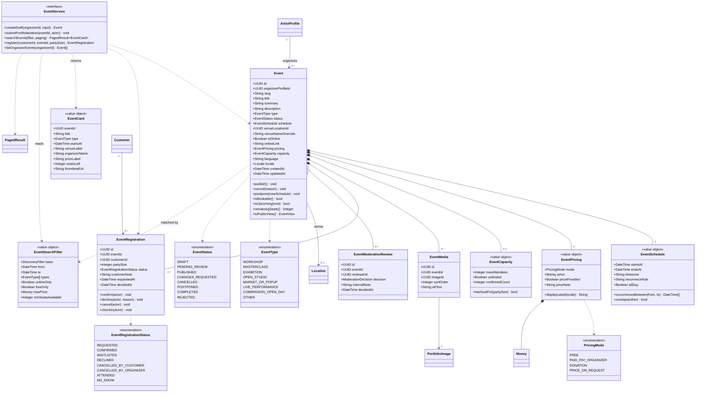
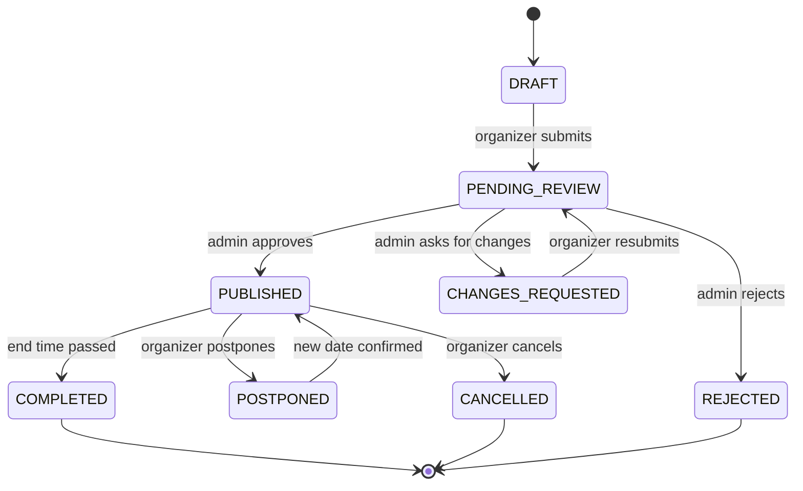

# Astarte — Addendum: Events, AI Models and Methods

**Companion to:** `CLASS_DIAGRAM.md`
**Status:** Design draft. Nothing is implemented. The repository `saitaflex/artsart` is currently empty (no commits), so this is a greenfield design.

---

## Part A — Events

### A.1 What events are on Astarte

Artisans and artists can publish events they host or take part in:

- **Workshops and masterclasses** (pottery, leatherwork, calligraphy, painting)
- **Exhibitions and open studios**
- **Markets, pop-ups and fairs** (where an artisan has a stand)
- **Live performances** (music, theatre, dance)
- **Commission open days** (artist meets clients to discuss custom work)

Clients can browse events, search them with the AI assistant, and register (RSVP or buy a ticket) for events that allow it.

### A.2 Product rules

1. An event is created by an **artist or studio** (`ArtistProfile`). Only approved artists can publish events.
2. Events go through **moderation** like listings. Admins check that the event is real, the venue is correct, and the price is stated.
3. The AI only recommends **published events stored in the database**. It never invents dates, venues, prices or capacity.
4. Missing fields (price, capacity, date) are shown as "not provided", never guessed.
5. The platform does **not process payments** in the MVP. Ticketing is either "free registration" or "pay the organiser directly", and the UI says which.
6. A registration is a **request**, not a confirmed seat, until the organiser confirms it when the event has limited capacity.

### A.3 Event class diagram

**Explanation**

- **`Event`** is owned by an `ArtistProfile`. It is an aggregate root: schedule, pricing, capacity and media belong to it.
- **`EventSchedule`** stores the start and end in UTC, plus the local `timezone` (Tunisia is `Africa/Tunis`). `recurrenceRule` uses the iCalendar RRULE format (RFC 5545), so weekly workshops don't need one row per session. `occurrencesBetween()` expands them for search.
- **`EventPricing`** has a `mode` and a `priceProvided` flag. A `PAID_PAY_ORGANIZER` event with no price is shown as "price on request", never as zero.
- **`EventCapacity`** is nullable. `remainingSeats()` returns `null` for unlimited events, so the UI does not show a false "0 seats left".
- **`EventRegistration`** is a request with a state machine: `REQUESTED` → `CONFIRMED` / `WAITLISTED` / `DECLINED`. A customer cannot become `CONFIRMED` on their own. `checkIn()` and `NO_SHOW` support organisers tracking attendance.
- **`EventSearchFilter`** wraps the existing `DiscoveryFilter` (category, city, geo radius, locale) and adds date, type, online/free and seat filters. Events and artists therefore share one search path.
- **`EventCard`** is a read model with no private fields. It never exposes the exact venue address before a registration is confirmed (only `venueLabel`, such as the city).
- **`EventModerationReview`** follows the same pattern as image moderation: the reviewer's decision is recorded separately from any automated check.
- **`EventService`** is the single entry point for the UI and for the AI assistant. The AI calls `searchEvents()` and gets back records, which it then explains.

### A.4 Event state flow

### A.5 Client AI search for events

Example request: *"I want a pottery workshop in Sousse next weekend, under 50 TND, for two people."*

Pipeline:

1. `RequestUnderstandingService` extracts: type = `WORKSHOP`, category = pottery, city = Sousse, date range = next Saturday–Sunday, max price = 50 TND, seats = 2.
2. Missing or ambiguous values become a clarifying question (for example, "Do you want in-person or online?").
3. `EventService.searchEvents()` runs a **structured filter first** (date, city, price, seats). Only then is semantic ranking applied to the candidates.
4. `RecommendationService` returns a `RecommendationSet`. `OutputGuard` checks that every event ID in the reply exists in the result set.
5. The reply explains each result: why it matches, its price (or "not provided"), its seats (or "unlimited / not provided"), and whether registration is open.

If no event matches, the reply says so and offers to widen the date or city. It never invents an event.

---

## Part B — Best methods, models and concepts

Research summary from web searches run on this date. Each model is a **candidate to test**, not a decision. Benchmarks are reported by their authors and must be re-measured on Astarte data before we trust them.

### B.1 Image authenticity (AI-generated image detection)

| Option | What the evidence says | Use in Astarte |
|---|---|---|
| **Community-Forensics** detector | Top open-source detector in a Feb 2026 zero-shot benchmark of 16 methods on 12 datasets (about 75% mean accuracy). Performance was highly dataset-dependent. ([arXiv 2602.07814](https://arxiv.org/abs/2602.07814)) | First candidate for `AuthenticityService` |
| Commercial detection APIs | Scored highest overall in VendorBench-100 (July 2026), which compared 36 models. ([alphaXiv](https://www.alphaxiv.org/abs/2607.06254)) | Optional paid provider behind the same adapter, if budget allows |
| Vision LLM as second opinion | Lower ranking power than the best open-source detector in the same benchmark. | Explanation only, never the decision |
| DailyBench | Covers recent full-image generators and object-level manipulation, 140K images. ([HF papers](https://huggingface.co/papers/2607.24016.md)) | Use as an evaluation set |
| NTIRE 2026 robustness set | Tests robustness to real-world post-processing (36 transforms). ([alphaXiv](https://www.alphaxiv.org/abs/2604.11487.md)) | Evaluate compressed and screenshot inputs |

**Method (must follow):**
- Build a **local golden set**: real artist photos of physical work, phone photos, screenshots, compressed JPEGs, and AI images. Label them with the admin team.
- Measure **false-positive rate on real human work** first. This is the harm that matters most.
- **Calibrate** the score (Platt scaling or isotonic regression on a held-out split). Only then show a confidence value. Until then `scoreCalibrated = false` and the UI shows the state, not a percentage.
- Re-evaluate on every model version change. Store the `modelVersion` in `AuthenticityAssessment`.

### B.2 Provenance (C2PA / Content Credentials)

| Library | Language | Notes |
|---|---|---|
| **c2pa-python** | Python 3.10+ | Read and validate manifests on the server. Install: `pip install c2pa-python`. ([PyPI](https://pypi.org/project/c2pa-python/)) |
| **c2pa-web** | Browser JS | Read manifests client-side for previews. The older `c2pa-js` SDK is deprecated. ([CAI docs](https://opensource.contentauthenticity.org/docs/c2pa-js/)) |
| **c2pa-node** | Node.js | Use if the backend is Node. |
| encypher-c2pa | Rust, Python, Go, JS | Verification-only alternative. ([docs.rs](https://docs.rs/crate/encypher-c2pa/1.0.0)) |

**Limitation to show in UI:** most cameras and phones do not sign C2PA manifests, and metadata can be stripped by social platforms. "No provenance found" is the normal state, not evidence of AI.

### B.3 Text and multilingual embeddings (search and matching)

| Model | Why | Note |
|---|---|---|
| **BGE-M3** (BAAI) | Dense, sparse and multi-vector retrieval in one model, 100+ languages. Covers Arabic, French and English. ([Emergent Mind](https://www.emergentmind.com/topics/bge-m3)) | Default choice |
| multilingual-e5-large | Close on Arabic RAG benchmark (70.31 vs 70.99 for BGE-M3, one secondary-source study). ([arXiv 2501.04635](https://arxiv.org/pdf/2501.04635)) | Fallback |
| Arctic-Embed 2.0 | Competitive multilingual retrieval, compares directly to BGE-M3. ([arXiv 2412.04506](https://arxiv.org/html/2412.04506v2)) | Benchmark candidate |
| **bge-reranker-v2-m3** | Cross-encoder reranker for the top-N candidates. | Add when relevance needs tuning |

**Caveat:** no French-specific comparison was found.

**Arabizi support (MVP, in scope).** Arabizi is Tunisian Derja written in Latin letters, with digits for sounds that have no Latin equivalent: 2 (ء/أ), 3 (ع), 5 (خ), 6 (ط), 7 (ح), 8 (غ), 9 (ق). Spelling is not standardised, so the same word can be typed several ways. Example: "nheb nemchi lel atelier" (نحب نمشي للأتيليي, "I want to go to the workshop").

Design:
1. **Script detection.** Classify the query as Arabic, Latin, or mixed.
2. **Normalisation.** `ArabiziNormalizer` maps digits to Arabic letters and produces candidate Arabic-script spellings. It only accepts candidates that match the curated dictionary, so it does not guess words.
3. **Dictionary expansion.** A maintained table maps Derja, French and English terms to Astarte categories, specialties and event types (for example, "poterie", "céramique", "pottery", "zeramik"). The team owns and extends this table.
4. **Typo tolerance.** Trigram matching (`pg_trgm`) on the dictionary and on listing titles, because Arabizi spelling varies.
5. **Semantic step.** BGE-M3 receives the expanded query. The dictionary is the safety net if embeddings handle Arabizi poorly.
6. **Grounding unchanged.** Expansion changes what is searched, not what is recommended. Results still come only from database records.

Test set: 100 Arabizi queries written and labelled by native speakers, covering events and listings. Metric: recall@10 on the labelled set. Target to set after the first run.

New components: `ArabiziNormalizer` (service) with `detectScript(text)`, `normalize(text) NormalizedQuery`, `expandTerms(terms) string[]`; value object `NormalizedQuery` (original, normalised, expanded terms, script, confidence).

### B.4 Hybrid search and geography (PostgreSQL stack)

- **Lexical:** PostgreSQL full-text search (`tsvector`) with an Arabic text-search configuration and French/English configs. Handles exact names, materials, and city names.
- **Semantic:** `pgvector` with an HNSW index. pgvector 0.8+ has **iterative index scans**, which fix the case where a `WHERE` filter leaves too few rows from a top-k scan. ([Crunchy Data](https://www.crunchydata.com/blog/hybrid-vector-search))
- **Geographic:** PostGIS `geography` type with a GiST index for radius and polygon queries.
- **Fusion:** **Reciprocal Rank Fusion (RRF)** to merge lexical and semantic rankings. It is simple, needs no score normalisation, and is a standard baseline.
- **Filter order:** a restrictive filter (city and date) reduces candidates before the vector step. Pre-filtering can hurt recall when the filter is very selective, so measure recall at each step. ([arXiv 2604.06616](https://arxiv.org/pdf/2604.06616))
- A partial HNSW index per region is worth testing if the regions are few and stable. This is my inference from the Crunchy Data guidance, not a published benchmark.

### B.5 Speech (voice discovery, Tunisian Derja)

| Model | Evidence | Note |
|---|---|---|
| **FarukSTT** (Whisper Large v3 fine-tune) | Model card: best publicly available ASR for Derja, WER 31.99% on its own validation split (v2). Baseline Whisper Large v3 above 50%. Covers code-switching with French and English. ([HF](https://huggingface.co/medyas/FarukSTT)) | Default candidate; numbers are self-reported |
| Whisper Tunisien (TunLangModel series) | Whisper small/medium fine-tunes, Apache-2.0. Best variant WER 45.3 on its eval set; sparse model cards. ([HF](https://huggingface.co/Arbi-Houssem/TunLangModel_test1.17/blob/main/README.md)) | Smaller footprint, weaker results |
| Whisper Large v3 (base) | Baseline. | Reference only |

**Method:** record 100+ real customer utterances across Derja, French and Arabic, and measure WER on them before choosing. Voice output must go through the **same** `DiscoveryServiceFacade` as text. TTS was not researched in this pass and needs a separate evaluation.

### B.6 Recommendation (artisans, listings, events)

- **Two-tower retrieval:** user tower and item tower trained on interactions. Item embeddings are precomputed, so query-time cost is a fast ANN lookup. ([LinkedIn paper, arXiv 2510.14223](https://arxiv.org/html/2510.14223v1))
- **Cold start is the main problem for Astarte.** Few artists and events have interaction history. Start with **content-based** retrieval (categories, specialties, city, price, date) and use collaborative signals only once data exists.
- **Hybrid retrieval** (dense + lexical) for domain terms. Validate against a collaborative-only baseline, since fusion does not always win. ([HF forum thread](https://discuss.huggingface.co/t/seeking-advice-strategy-for-embedding-multiple-subjective-reviews-in-one-time-event-domain-recommendations/172148))
- **Reranking:** retrieve about 100 candidates cheaply, then rerank the top 20–30 with a heavier model (cross-encoder or LLM). Latency for LLM reranking is a rough estimate from a low-authority source (200–500 ms); measure it.
- **Events specifically:** use date, distance and category as hard constraints. Popularity is weak early on, so do not rank by it. Expired events must be excluded from every result.
- **Fairness:** rank by relevance, not by payment. New artisans need exposure. Track exposure share per artisan as a KPI.

### B.7 Language models (AI assistants)

- **No model is chosen yet.** Use the provider adapter (`ProviderAdapter<T>`) so the model can change.
- **Conversation and explanation:** a capable hosted model (Claude Sonnet 5.5 is a candidate, model id `claude-sonnet-5-5`).
- **Cheap intent parsing and classification:** a small model (Claude Haiku 5.5, `claude-haiku-5-5`) is a candidate for `RequestUnderstandingService`.
- **Open-weight alternative for cost or privacy:** a self-hosted model. Evaluate it on Arabic, French and Derja before adopting it. Not researched in this pass.
- **Output must be grounded:** the model receives only retrieved records, must cite record IDs, and `OutputGuard` discards anything else.

### B.8 Core concepts to apply

1. **Retrieval-Augmented Generation (RAG) with strict grounding.** The database is the source of truth. The LLM explains, it does not invent.
2. **ID validation.** Every cited ID is checked against the retrieved set.
3. **Hybrid search with RRF.** Lexical plus vector, merged by rank.
4. **Two-stage ranking.** Cheap retrieval, then precise reranking on a small set.
5. **Calibration.** No percentage is shown unless it is calibrated on labelled data.
6. **Human-in-the-loop.** Admin decisions are stored separately from model outputs and can override them.
7. **Golden evaluation sets.** Build them for: authenticity (real vs AI), search (Arabic, French, Derja, Arabizi), and voice (WER).
8. **Model cards and versioning.** Record model id, version, date and evaluation results for every model in use.
9. **Drift monitoring.** Track the share of "uncertain" results and the rate of admin overrides over time. A rising override rate means the model needs review.
10. **Privacy by design.** Store redacted user input in `AIInteraction`, minimise personal data, and avoid sending customer contact details to a model.
11. **Explainability.** Each recommendation states the criteria it matched and what data was missing.
12. **Fail closed.** If a provider is not configured, the feature says so. No fake result.

### B.9 Evaluation plan (before any build)

| Test | Data | Metric | Pass criterion (proposed) |
|---|---|---|---|
| Authenticity | Golden set of real and AI images | False-positive rate on real work | Lowest FPR on real work; decision threshold set by admin team |
| Search | 100+ queries in Arabic, French, Derja, Arabizi | Recall@10, nDCG@10 | Relevant listing in top 10 for ≥ 80% of queries (proposed) |
| Events search | 50 event queries with date/city/price | Filter accuracy (hard constraints) | 100% of results satisfy hard constraints |
| Voice | 100+ recorded utterances | WER | Chosen model has the lowest WER on the team's own recordings |
| Grounding | 100 AI replies | Count of uncited or unknown IDs | Zero unknown IDs reach the user |

The thresholds are proposals for the team to set. They are not measured results.

---

## Part C — New items for the class diagram

Added to the design (already reflected in Part A):

| Class | Kind | Section |
|---|---|---|
| Event | entity, aggregate root | Events |
| EventSchedule | value object (RRULE) | Events |
| EventPricing | value object | Events |
| EventCapacity | value object | Events |
| EventRegistration | entity with state machine | Events |
| EventMedia | entity | Events |
| EventSearchFilter / EventCard | value objects | Events |
| EventService | interface | Events |
| EventModerationReview | entity | Events |
| EventType, EventStatus, EventRegistrationStatus, PricingMode | enumerations | Events |

Additional AI/ML components to add later to the AI section:

- `EmbeddingProvider` (interface) with `embed(texts) -> vector[]`, `dimensions()`, `modelId()`
- `RerankerProvider` (interface) with `rerank(query, candidates) -> scored[]`
- `SpeechToTextProvider` and `TextToSpeechProvider` (interfaces)
- `EvaluationRun` (entity): dataset id, model version, metrics, date
- `CalibrationModel` (entity): method, parameters, dataset id

---

## Open questions

1. Are events **paid through the platform** later, or always paid directly to the organiser? (Affects `EventPricing` and whether a payment provider is needed.)
2. Should **online events** be in scope for the MVP?
3. Who can create events: all approved artists, or only those with **verified** status?
4. ~~Is Arabizi a must-support search input?~~ **Resolved:** yes, in MVP search (see B.3).
5. Is the **hosted LLM** acceptable under the data-protection plan, or must the assistant run on a self-hosted model?

---

## Sources

- Community-Forensics benchmark: https://arxiv.org/abs/2602.07814
- VendorBench-100: https://www.alphaxiv.org/abs/2607.06254
- DailyBench: https://huggingface.co/papers/2607.24016.md
- NTIRE 2026 AI-generated image detection: https://www.alphaxiv.org/abs/2604.11487.md
- c2pa-python: https://pypi.org/project/c2pa-python/
- c2pa-js (deprecated, see replacement): https://opensource.contentauthenticity.org/docs/c2pa-js/
- BGE-M3 overview: https://www.emergentmind.com/topics/bge-m3
- Arabic RAG embedding comparison: https://arxiv.org/pdf/2501.04635
- Arctic-Embed 2.0: https://arxiv.org/html/2412.04506v2
- Hybrid search with pgvector: https://www.crunchydata.com/blog/hybrid-vector-search
- Filtering and recall tradeoffs: https://arxiv.org/pdf/2604.06616
- FarukSTT (Derja ASR): https://huggingface.co/medyas/FarukSTT
- Whisper Tunisien TunLangModel: https://huggingface.co/Arbi-Houssem/TunLangModel_test1.17/blob/main/README.md
- Two-tower retrieval at LinkedIn: https://arxiv.org/html/2510.14223v1
- Event recommendation discussion: https://discuss.huggingface.co/t/seeking-advice-strategy-for-embedding-multiple-subjective-reviews-in-one-time-event-domain-recommendations/172148
- Two-tower vs vector DB (low-authority, latency figures not verified): https://dev.to/gentic_news/two-tower-vs-vector-db-llm-which-wins-for-recsys-at-scale-pip
