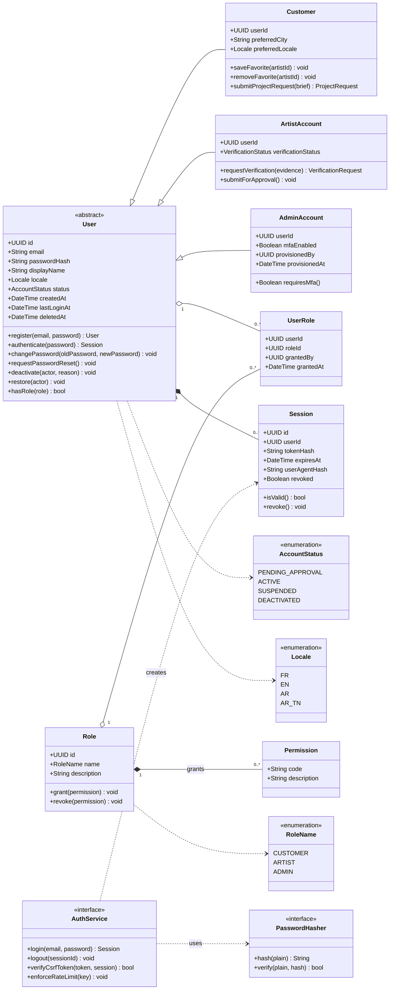
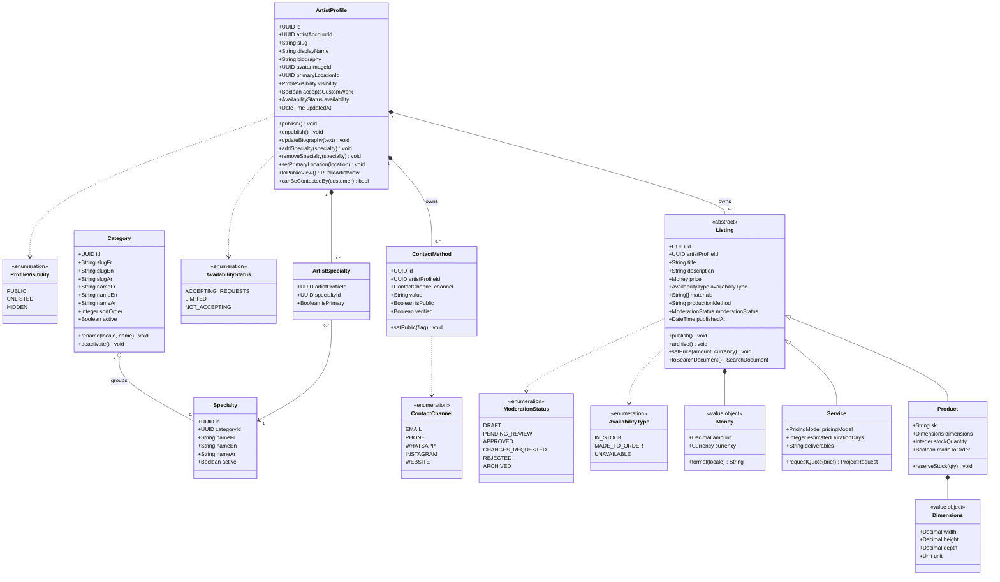
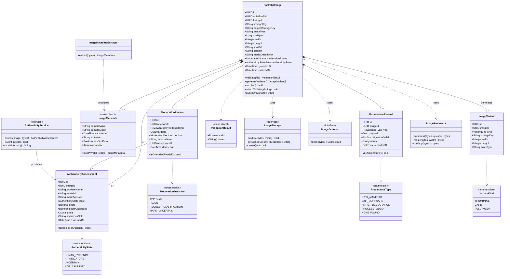
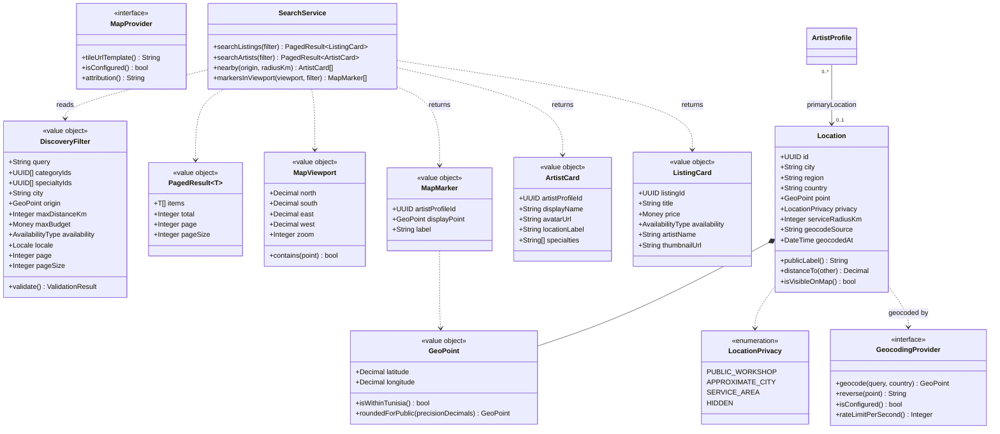
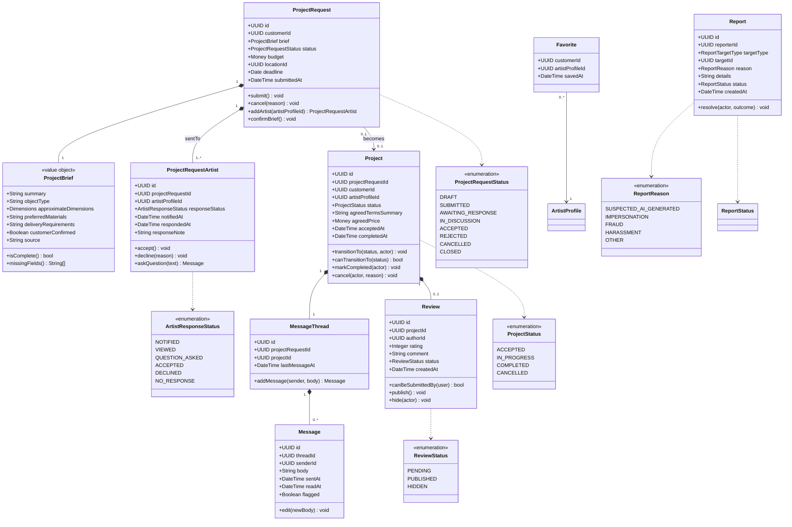
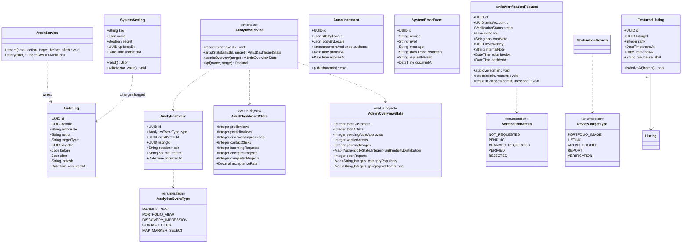

# Astarte — Object Class Diagram (Phase 0 specification)

**Brand:** Astarte (formerly "HUMANLY" in the master prompt)
**Slogan:** Real People. Real Creativity.
**Status:** Design draft for review. No code exists yet. Nothing here is implemented.

**Philosophy constraint that shapes every class:** the AI layer only *reads* and *explains* database records. No class in the AI section creates artworks, designs, or artists. Every recommendation is a `ScoredResult` that points to a persisted `Listing` or `ArtistProfile` ID.

---

## How to read this document

- Each diagram is a Mermaid `classDiagram`. GitHub, VS Code (Mermaid extension) and most Markdown viewers render it.
- Stereotypes: `<<abstract>>`, `<<interface>>`, `<<enumeration>>`, `<<value object>>`.
- Visibility: `+` public, `-` private, `#` protected.
- Multiplicity: `1`, `0..1`, `0..*`, `1..*`.
- Relationships: `<|--` inheritance, `*--` composition (owned, deleted with parent), `o--` aggregation (shared), `-->` association, `..>` dependency, `..|>` implementation.
- `Id` fields are UUIDv7 unless stated otherwise. Timestamps are UTC `DateTime`.
- Methods listed are the *domain* operations. Repositories and controllers are not drawn; they follow the usual pattern (one repository per aggregate root).

---

## 1. Identity and access

Covers accounts, roles, the separate admin path, and sessions.

**Explanation**

- `User` is the single identity table. Every person has exactly one `User` row, which holds login data only.
- `Customer`, `ArtistAccount` and `AdminAccount` are *role-specific extensions*. Keeping them separate means a customer never carries artist-only columns, and admin data (MFA, provisioning trail) never leaks into public profile code.
- `Role` and `Permission` implement RBAC. `UserRole` is a join entity so one account can hold several roles (for example a studio owner who is also a customer). Authorization is checked on the server by permission code, never by frontend visibility.
- `AdminAccount` has no self-registration path. `provisionedBy` records who created it. There is no public endpoint that sets `ADMIN`.
- `Session` stores only a hash of the token. `revoke()` supports forced logout after suspension.
- `PasswordHasher` is an interface so the algorithm (Argon2id preferred, bcrypt acceptable) can be swapped without touching the auth logic.

---

## 2. Artist profiles, catalog, and contact

Covers what an artist publishes and how customers reach them.

**Explanation**

- `ArtistProfile` is the aggregate root for everything public about an artist. Deleting a profile cascades to its listings and contact methods (composition).
- `Listing` is abstract. `Product` (has stock and dimensions) and `Service` (has duration and quote flow) share price, materials and moderation state.
- `AvailabilityType` (on the listing) and `AvailabilityStatus` (on the profile) are separate on purpose. "This vase is in stock" and "this artist is taking commissions this month" are different facts.
- `ContactMethod.isPublic` is opt-in and defaults to `false`. The public view only shows contacts with `isPublic = true` and `verified = true`.
- `Money` and `Dimensions` are value objects. Currency is stored with the amount so that TND and EUR listings never get mixed up in search.
- Listing `price` is nullable. If the artist did not provide a price, the UI shows "price on request". The AI must never fill it in.

---

## 3. Portfolio images, moderation and authenticity

Covers upload pipeline, storage, metadata, provenance, the AI-slop check, and human review. The model is kept deliberately separate from the human decision.

**Explanation**

- `PortfolioImage` stores two keys: `originalStorageKey` (private bucket, never exposed) and `storageKey` (web-optimised copy). Public URLs come from `publicUrl(variant)` and are short-lived signed URLs. Raw bucket paths are never returned.
- `ImageMetadata` is a value object. `stripPrivateFields()` removes GPS and other personal data before anything is shown publicly. `hasGpsData` is kept so admins know it was stripped.
- `ProvenanceRecord` holds evidence (C2PA manifest, EXIF software tag, an artist's declaration). `NONE_FOUND` is a valid, expected state, not an error.
- `AuthenticityAssessment` is an **ML prediction**. It stores `modelId` and `modelVersion` so results can be reproduced. `score` is only meaningful when `scoreCalibrated = true`; otherwise it is `null`.
- `ModerationReview` is the **human decision**. It is a separate row from the assessment, so an admin can override the model and the override is still recorded. `isOverrideOfModel()` compares the decision against `AuthenticityState`.
- `AuthenticityState` has `UNCERTAIN` as a first-class value. The system never forces a binary human/AI result.
- `AuthenticityService` is an interface. The first implementation can be a disabled stub that returns `NOT_ASSESSED` with a clear message, so the admin sees "not configured" rather than a fake score.
- `ImageScanner` covers malware and file-type checks. `ImageProcessor` covers compression, resizing and WebP output.

---

## 4. Geography and discovery map

Covers artist locations, privacy levels, geocoding and the map/list search.

**Explanation**

- `Location` belongs to an artist and is never created from a customer's exact address. Customers never have a `Location` row.
- `LocationPrivacy` controls what is shown. `HIDDEN` produces no marker and no distance. `APPROXIMATE_CITY` and `SERVICE_AREA` store the point and show a rounded or radius-based circle. `PUBLIC_WORKSHOP` shows the point.
- `GeoPoint.roundedForPublic()` is applied before the coordinate leaves the server, so the public API never returns full precision for private locations.
- `SearchService` is the one place where filters become queries. The AI layer calls it too (see section 6), so map, list and AI results always come from the same code path.
- `MapMarker` is only created when `isVisibleOnMap()` is true. An artist without coordinates gets no marker.
- `GeocodingProvider` and `MapProvider` are interfaces. The map library is a frontend decision (Leaflet + OpenStreetMap tiles is the low-cost default, MapLibre is the upgrade path). Geocoding is server-side, rate-limited, and results are cached per artist location, not per keystroke.

---

## 5. Customer requests, projects, and communication

Covers the custom-request workflow from brief to completion.

**Explanation**

- `ProjectRequest` is created by a customer. `ProjectBrief` is a value object containing only what the customer provided, plus `missingFields()`. It never contains an AI-invented design.
- `ProjectRequestArtist` is the join between a request and each contacted artist. Each artist responds independently. A `Project` is only created when an artist calls `accept()`. The status `ACCEPTED` is never inferred from the customer's action.
- `Project.transitionTo()` enforces a state machine (`canTransitionTo`). Example: `COMPLETED` cannot go back to `IN_PROGRESS`.
- `MessageThread` is attached to a request first and then to a project. Messages are visible only to the customer and the one artist in that thread.
- `Review` requires a completed `Project`. `canBeSubmittedBy()` ensures only the customer on that project can review it.
- `Report` is generic. `SUSPECTED_AI_GENERATED` routes to the same admin queue as authenticity checks.
- `agreedPrice` is only set by the artist and customer together. The platform does not process payments in the MVP.

---

## 6. Trust, administration, audit and analytics

Covers the admin dashboard data model, audit trail, settings, and KPI events.

**Explanation**

- Every admin write goes through `AuditService.record()`. The log stores `before` and `after` snapshots and a **hash** of the IP, never the raw address.
- `SystemSetting` holds AI and integration configuration (provider name, model id, enable/disable). Secrets are *not* stored here. They stay in environment variables. `secret` is a flag that makes the admin UI show "set / not set" instead of the value.
- `ArtistVerificationRequest` is the verification queue. Approval changes `VerificationStatus`, and an audit entry is written.
- `FeaturedListing` needs `disclosureLabel` so the UI always shows "Featured / Sponsored" as the advertising disclosure requires.
- `AnalyticsEvent` stores a `sessionHash`, not a user ID, for guest traffic. This keeps the KPI data useful without tracking individuals unnecessarily.
- `ArtistDashboardStats` and `AdminOverviewStats` are **computed from queries** over `AnalyticsEvent` and the operational tables. They are never stored as hardcoded numbers.
- `SystemErrorEvent.stackTraceRedacted` is stored after removing secrets and personal data.

---

## 7. AI discovery, AI services and integration adapters

Covers the modular AI layer. Each AI service has a defined input, output and failure mode. The database remains the source of truth.

```mermaid
classDiagram
direction TB

class AIInteraction {
  +UUID id
  +UUID userId
  +String sessionHash
  +AIFeature feature
  +String userInputRedacted
  +UUID[] retrievedListingIds
  +UUID[] citedArtistIds
  +String modelProvider
  +String modelId
  +Integer tokensIn
  +Integer tokensOut
  +String outcome
  +DateTime createdAt
}

class RequestUnderstandingService {
  <<interface>>
  +parse(message, history, locale) ParsedIntent
}

class ParsedIntent {
  <<value object>>
  +IntentType type
  +DiscoveryFilter filter
  +String[] clarifyingQuestions
  +Decimal confidence
  +Boolean wantsCustomCommission
}

class RecommendationService {
  +recommend(intent) RecommendationSet
  +rankCandidates(candidates, intent) ScoredResult[]
  +validateCitedIds(reply, retrieved) UUID[]
}

class ScoredResult {
  <<value object>>
  +UUID recordId
  +RecordType recordType
  +Decimal relevanceScore
  +String[] matchedCriteria
  +String[] unknownFields
  +Boolean isExistingProduct
}

class RecommendationSet {
  <<value object>>
  +ScoredResult[] results
  +Boolean noGoodMatch
  +String noResultsMessage
  +String[] suggestedRefinements
}

class ConversationService {
  <<interface>>
  +respond(intent, recommendationSet, locale) AssistantReply
}

class AssistantReply {
  <<value object>>
  +String text
  +UUID[] referencedRecordIds
  +Boolean containsCommissionQuestion
  +Locale locale
}

class BusinessAssistantService {
  <<interface>>
  +suggestProfileImprovements(profile) Suggestion[]
  +explainAnalytics(stats) String
  +prepareQuotationDraft(brief, artistInput) QuotationDraft
}

class SustainabilityEstimator {
  <<interface>>
  +estimate(listing, materials, method) SustainabilityAssessment
  +suggestAlternatives(materials) MaterialSuggestion[]
}

class SustainabilityAssessment {
  +UUID id
  +UUID listingId
  +String methodology
  +String lifecycleBoundary
  +Json estimates
  +Json assumptions
  +String[] dataSources
  +String uncertaintyNote
  +EvidenceLevel evidenceLevel
  +DateTime assessedAt
}

class SpeechService {
  <<interface>>
  +transcribe(audio, locale) String
  +synthesize(text, locale) Audio
  +isConfigured() bool
}

class ProviderAdapter~T~ {
  <<interface>>
  +isConfigured() bool
  +healthCheck() ProviderHealth
  +invoke(request) T
}

class ProviderUnavailableError {
  +String providerName
  +String reason
  +Boolean retryable
}

class AIProviderConfig {
  <<value object>>
  +String aiProvider
  +String aiModel
  +Boolean enabled
  +Integer timeoutMs
  +Integer monthlyBudgetCents
}

class OutputGuard {
  +rejectUnknownIds(reply, allowedIds) String
  +rejectFabricatedFacts(reply, record) String
  +stripContactDetailsNotPublic(reply) String
  +blockArtisticGeneration(reply) String
}

class AuthenticityEvidence {
  <<value object>>
  +String checkedInput
  +String result
  +String limitation
}

class IntentType {
  <<enumeration>>
  FIND_EXISTING_PRODUCT
  FIND_CREATOR_FOR_COMMISSION
  EXPLAIN_PROCESS
  CLARIFY
  OUT_OF_SCOPE
}

class RecordType {
  <<enumeration>>
  LISTING
  ARTIST_PROFILE
}

class AIFeature {
  <<enumeration>>
  CUSTOMER_DISCOVERY
  REQUEST_BRIEF
  ARTIST_BUSINESS
  SUSTAINABILITY
  VOICE_DISCOVERY
}

class EvidenceLevel {
  <<enumeration>>
  MEASURED
  ESTIMATED
  ASSUMED
  NO_EVIDENCE
}

class ProviderHealth {
  <<enumeration>>
  OK
  DEGRADED
  NOT_CONFIGURED
  UNREACHABLE
}

class DiscoveryServiceFacade {
  +handleCustomerMessage(userId, message, locale) AssistantReply
}

RequestUnderstandingService ..> ParsedIntent : produces
RequestUnderstandingService ..|> ProviderAdapter
ConversationService ..|> ProviderAdapter
BusinessAssistantService ..|> ProviderAdapter
SustainabilityEstimator ..|> ProviderAdapter
SpeechService ..|> ProviderAdapter
DiscoveryServiceFacade ..> RequestUnderstandingService
DiscoveryServiceFacade ..> RecommendationService
DiscoveryServiceFacade ..> ConversationService
DiscoveryServiceFacade ..> OutputGuard
DiscoveryServiceFacade ..> AIInteraction : logs
RecommendationService ..> SearchService : queries DB only
RecommendationService ..> RecommendationSet
RecommendationSet *-- "0..*" ScoredResult
ConversationService ..> AssistantReply
OutputGuard ..> AssistantReply : validates
ProviderAdapter ..> ProviderUnavailableError : throws
ProviderAdapter ..> AIProviderConfig
SustainabilityEstimator ..> SustainabilityAssessment : produces
SustainabilityAssessment ..> EvidenceLevel
ParsedIntent ..> IntentType
ScoredResult ..> RecordType
AIInteraction ..> AIFeature
ProviderAdapter ..> ProviderHealth
AuthenticityService ..|> ProviderAdapter
AuthenticityService ..> AuthenticityEvidence
```

**Explanation**

- **Pipeline for customer discovery:** `RequestUnderstandingService` turns text into a `ParsedIntent` (filters, not results). `RecommendationService` runs `SearchService` against the database. `ConversationService` writes the explanation from retrieved records only. `OutputGuard` checks the reply before it is sent.
- `RecommendationService.validateCitedIds()` discards any ID that was not in the retrieved set. The LLM cannot cite a record it was not given.
- `OutputGuard.blockArtisticGeneration()` detects replies that propose a design or artwork for the artist to make. Those replies are replaced with a neutral message and a clarifying question.
- `ScoredResult.isExistingProduct` distinguishes a listing the artist already offers from an artist who might take a commission. The UI labels them differently.
- `ScoredResult.unknownFields` lists missing data (no price, no availability). The UI shows "not provided" rather than leaving a gap or guessing.
- **Business assistant** and **customer assistant** are separate services with separate prompts and separate permissions. The business assistant can read the artist's own analytics but cannot read other artists' data.
- `ProviderAdapter<T>` is the common contract for every external service: `isConfigured()`, `healthCheck()`, `invoke()`. If a provider is not configured, the adapter throws `ProviderUnavailableError` with `retryable = false`. It never returns a fake result.
- `AIProviderConfig` maps to the environment variables (`AI_PROVIDER`, `AI_API_KEY`, and so on). The API key itself is never inside this object.
- `AIInteraction` logs the retrieved IDs and cited IDs, so every recommendation can be traced later. User input is stored redacted.
- `SpeechService` is a placeholder for voice. It must call the same `DiscoveryServiceFacade` path as text, so voice cannot bypass the rules.
- `SustainabilityAssessment` must carry `methodology`, `lifecycleBoundary`, `dataSources` and `evidenceLevel`. The UI cannot show an environmental claim without an evidence level.

---

## 8. Enumeration index

| Enum | Values | Used by |
|---|---|---|
| RoleName | CUSTOMER, ARTIST, ADMIN | Role |
| AccountStatus | PENDING_APPROVAL, ACTIVE, SUSPENDED, DEACTIVATED | User |
| Locale | FR, EN, AR, AR_TN | User, Category, Specialty, AssistantReply |
| VerificationStatus | NOT_REQUESTED, PENDING, CHANGES_REQUESTED, VERIFIED, REJECTED | ArtistVerificationRequest |
| ContactChannel | EMAIL, PHONE, WHATSAPP, INSTAGRAM, WEBSITE | ContactMethod |
| AvailabilityType | IN_STOCK, MADE_TO_ORDER, UNAVAILABLE | Listing, DiscoveryFilter |
| AvailabilityStatus | ACCEPTING_REQUESTS, LIMITED, NOT_ACCEPTING | ArtistProfile |
| ProfileVisibility | PUBLIC, UNLISTED, HIDDEN | ArtistProfile |
| ModerationStatus | DRAFT, PENDING_REVIEW, APPROVED, CHANGES_REQUESTED, REJECTED, ARCHIVED | Listing, PortfolioImage |
| ModerationDecision | APPROVE, REJECT, REQUEST_CLARIFICATION, MARK_UNCERTAIN | ModerationReview |
| AuthenticityState | HUMAN_EVIDENCE, AI_INDICATORS, UNCERTAIN, NOT_ASSESSED | AuthenticityAssessment |
| ProvenanceType | C2PA_MANIFEST, EXIF_SOFTWARE, ARTIST_DECLARATION, PROCESS_VIDEO, NONE_FOUND | ProvenanceRecord |
| VariantKind | THUMBNAIL, CARD, FULL_WEBP | ImageVariant |
| LocationPrivacy | PUBLIC_WORKSHOP, APPROXIMATE_CITY, SERVICE_AREA, HIDDEN | Location |
| ProjectRequestStatus | DRAFT, SUBMITTED, AWAITING_RESPONSE, IN_DISCUSSION, ACCEPTED, REJECTED, CANCELLED, CLOSED | ProjectRequest |
| ProjectStatus | ACCEPTED, IN_PROGRESS, COMPLETED, CANCELLED | Project |
| ArtistResponseStatus | NOTIFIED, VIEWED, QUESTION_ASKED, ACCEPTED, DECLINED, NO_RESPONSE | ProjectRequestArtist |
| ReviewStatus | PENDING, PUBLISHED, HIDDEN | Review |
| ReportReason | SUSPECTED_AI_GENERATED, IMPERSONATION, FRAUD, HARASSMENT, OTHER | Report |
| ReportTargetType / ReportStatus | Target: ARTIST_PROFILE, LISTING, MESSAGE, REVIEW · Status: OPEN, IN_REVIEW, RESOLVED, DISMISSED | Report |
| ReviewTargetType | PORTFOLIO_IMAGE, LISTING, ARTIST_PROFILE, REPORT, VERIFICATION | ModerationReview |
| AnalyticsEventType | PROFILE_VIEW, PORTFOLIO_VIEW, DISCOVERY_IMPRESSION, CONTACT_CLICK, MAP_MARKER_SELECT | AnalyticsEvent |
| AnnouncementAudience | ALL, CUSTOMERS, ARTISTS, ADMINS | Announcement |
| IntentType | FIND_EXISTING_PRODUCT, FIND_CREATOR_FOR_COMMISSION, EXPLAIN_PROCESS, CLARIFY, OUT_OF_SCOPE | ParsedIntent |
| RecordType | LISTING, ARTIST_PROFILE | ScoredResult |
| AIFeature | CUSTOMER_DISCOVERY, REQUEST_BRIEF, ARTIST_BUSINESS, SUSTAINABILITY, VOICE_DISCOVERY | AIInteraction |
| EvidenceLevel | MEASURED, ESTIMATED, ASSUMED, NO_EVIDENCE | SustainabilityAssessment |
| ProviderHealth | OK, DEGRADED, NOT_CONFIGURED, UNREACHABLE | ProviderAdapter |

---

## 9. Value objects and generic types (summary)

| Type | Kind | Purpose |
|---|---|---|
| Money | value object | Amount + currency (TND, EUR, USD). Never a bare number. |
| Dimensions | value object | Width, height, depth, unit (cm, in). |
| GeoPoint | value object | Latitude, longitude, public rounding. |
| ImageMetadata | value object | Sanitised EXIF; GPS removed before public use. |
| ValidationResult | value object | Valid flag and error list. |
| DiscoveryFilter | value object | Every search criterion in one place. |
| MapViewport / MapMarker | value objects | Map bounds and marker data. |
| PagedResult~T~ | generic value object | Paginated lists for any entity. |
| ArtistCard / ListingCard | value objects | Read models for search results (no private fields). |
| ProjectBrief | value object | Customer requirements, with `missingFields()`. |
| ParsedIntent / RecommendationSet / ScoredResult / AssistantReply | value objects | AI pipeline contracts. |
| AIProviderConfig | value object | Non-secret provider settings. |
| ProviderAdapter~T~ | generic interface | Contract for every external service. |
| Map~K,V~ | collection type | Used in analytics distributions. |

---

## 10. Design decisions to review

1. **Separate ML prediction and human decision.** `AuthenticityAssessment` and `ModerationReview` are different tables. This keeps the model's output auditable and shows when an admin overrode it.
2. **No AI writes to the catalog.** The AI reads `Listing` and `ArtistProfile` through `SearchService`. It has no write path to those classes.
3. **Admin is a separate table, not a flag.** `AdminAccount` allows MFA and provisioning fields without touching customer or artist code.
4. **Location privacy is enforced in the value object** (`roundedForPublic`), not left to the frontend.
5. **Provider adapters fail closed.** An unconfigured integration returns `ProviderUnavailableError`, never a simulated result.
6. **Sustainability claims require `EvidenceLevel`.** Without evidence, the UI shows "no evidence" rather than a figure.
7. **Money and currency are explicit** because Tunisian dinar and euro listings will coexist.

---

## Open questions for you

1. **Brand rename.** I applied "Astarte" to this spec. Confirm this is the name you want everywhere (domain, UI, docs), and whether "HUMANLY" should be dropped completely.
2. **Admin provisioning.** Do you want admins created by a CLI command on the server, or by an existing admin invite flow?
3. **Currency.** Is TND the only price currency for the MVP?
4. **Authenticity model.** No model has been selected or tested. The `AuthenticityService` is a stub until we evaluate candidates.
5. **Project status.** Is `ProjectRequestStatus` and `ProjectStatus` as two enums acceptable, or should it be one enum?

---

## Notes on this document

- No existing Astarte / HUMANLY codebase was found on the Desktop, in Documents or in OneDrive (searched folder names and top-level contents). The only web project there is `Desktop\portfolio`, which is an unrelated personal portfolio. This diagram is therefore a **greenfield design**, not a reverse-engineered one.
- The Mermaid blocks have not been rendered and checked in a viewer yet. Check them in GitHub or VS Code before sharing.
